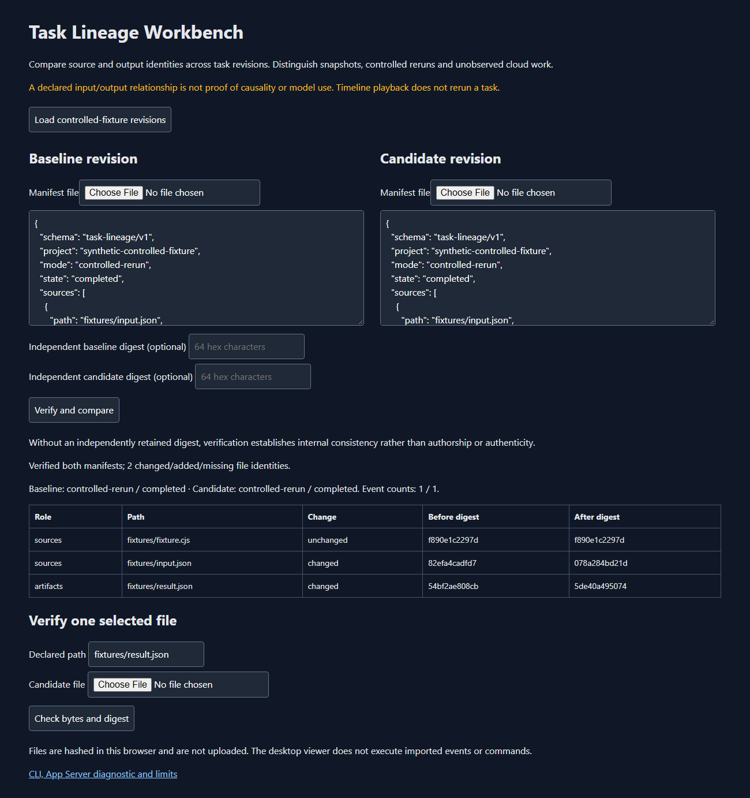

# Task Lineage Workbench for Codex workflows

Save a record of selected input and output files after a task, then compare it with a later run. The viewer separates changes to the inputs from changes to the results so you can see what needs investigation.

A script, data file or AI-assisted coding task produces a different result, but the conversation and working files have changed since the earlier run. You want a small, checkable record of the files you chose to associate with each result.

**Example:** The sample runs the same small program twice. A multiplier changes from 2 to 3. The viewer shows that the program file stayed the same while the input and output files changed. This is a real local-program example, not a record of an AI model turn.

**What you install:** A separate file-comparison viewer and command-line recorder.

**Current scope:** This is an independent workbench, not a modified Codex desktop app. It records declared file relationships; it cannot prove which files an AI used or why it produced an edit. Automatic AI reruns and cloud-task history are not implemented.

[Live guide](https://az9713.github.io/rea-codex-lineage/) · [Download packages](https://github.com/az9713/rea-codex-lineage/releases/tag/v0.1.1)

## Before and after

| Before | With this workbench |
| --- | --- |
| An output file and a task transcript can drift apart. | A revision commits to declared source and output file hashes, plus an explicit event/mode envelope. |
| An unchanged output can hide a changed input. | Compare source and artifact identities separately. |
| Playback, rerun and an interrupted cloud task can look similar. | Mode and completion state are explicit; the viewer never executes imported events. |
| A rewritten local checksum can look valid. | Optionally check the manifest against a digest retained independently. |



## Version 0.1.1: verification you can audit

This patch fixes review findings in the independent workbench. Comparisons now include **both hash and byte length**, so contradictory length metadata cannot be labeled unchanged. CLI manifest files are size-checked from an open descriptor before a buffer is allocated. Imported source/artifact lists each enforce 100 files and 32 MB; verification also shares an actual read budget across changed files rather than trusting their declared sizes. Browser hash fields must be strings with the same schema as the core.

**20 core/actual CLI tests and 14 real Chromium checks passed.** These include allocation/read instrumentation, exact boundary acceptance, actual CLI rejection on both comparison inputs, real browser metadata-change display and malformed/over-budget manifest refusal. The Windows executable is separately smoke-tested after ZIP extraction; that checks renderer loading and isolation, while browser/core tests establish the application behavior. See the [core](docs/core-verification.json), [browser](docs/browser-verification.json), and [desktop](docs/desktop-verification.json) evidence. No AI/model task was executed by those checks.

## Run

The Windows ZIP includes `TaskLineageWorkbench.exe` and its Electron runtime. Extract and run it from a writable directory. It processes selected manifests/files locally; profile data stays beside the executable. The browser version works on GitHub Pages or a local HTTP server. No model subscription is needed for the viewer.

The example manifests come from two real executions of the included deterministic fixture, with one input factor changed. They are not records of an AI model turn.

The web ZIP contains `docs/`; serve that directory over HTTP (for example `python -m http.server 8000` from `docs/`) or use GitHub Pages. The controlled examples use fetch; direct `file://` example loading is not claimed. The source ZIP contains all original code, tests, fixtures, docs, lockfile, CI and packaging scripts. Verify archives with `SHA256SUMS-0.1.1.txt` and `package-verification-0.1.1.json`. Historical0.1.0 archives remain unchanged.

## Capture your own revision

Node22 or later:

```sh
node path/to/src/cli.cjs snapshot my-project src/analysis.py,input.json result.csv revision-a.json
node path/to/src/cli.cjs verify revision-a.json
node path/to/src/cli.cjs compare revision-a.json revision-b.json
```

Run from your intended workspace. Paths in the source/artifact lists are relative; output must be a new file inside that workspace. Snapshotting does not execute the task or prove those inputs caused the outputs. No recursive source discovery is performed. Import both manifests into the viewer to inspect separate source/artifact changes; select a file to check its candidate hash.

Limits:100 files/32MB per source or artifact list;8MB per file;200 combined file identities;2,000 declared events;5MB manifest input. Symlinks/linked ancestors, outside paths, ambiguous case-insensitive names, duplicate JSON keys, unsafe numbers and unpaired Unicode are refused. File snapshots are not atomic filesystem transactions.

## Public App Server diagnostic

Install the pinned public CLI dependency locally, then run from this checkout:

```sh
node src/cli.cjs probe
```

This actually starts CLI0.166.0's local App Server and completes initialize/thread-list diagnostics. The child uses a checkout-contained home/temp/profile, an allowlisted environment and process-local authentication. No login, logout, model turn, approval grant or cloud replay occurs. The private raw diagnostic is written to `investigation/app-server-diagnostic.private.json`; do not publish real task transcripts or credentials.

The desktop viewer is an independent implementation. It is not a modified Codex desktop binary and does not replace the agent interface. Automated task execution, live event streaming, interruption/resumption controls and cloud lineage are not implemented. CLI0.166.0 is not a Codex desktop version.

## Build and reproduce

```sh
node --test tests/manifest.test.cjs
node scripts/build.cjs
node scripts/browser-test.cjs
```

Windows desktop build: install pinned Electron45.2.1 in this checkout with a local cache, then `python scripts/package-desktop.py`. Run `python scripts/release.py` to create the versioned Windows/web/corresponding-source archives and receipts. The helper refuses an existing output directory; select a fresh `output_directory` in `electron-app.json` for a deliberate new build. The public npm lock pins tool dependencies; avoid installing from an uninitialized ancestor directory. On PowerShell set `ELECTRON_CACHE` and `npm_config_cache` to checkout-contained `.runtime` subdirectories and use an explicit absolute `--prefix` for installation.

Core/actual CLI-process tests, Chromium behavior tests, real App Server diagnostics and packaged renderer/isolation smoke have separate reports. A passing checksum is not authentication; retain an expected digest independently. Equal file hashes establish byte equality, not model use, environment equivalence or scientific correctness.

## Investigation and license

This project builds on [public App Server interfaces](https://github.com/openai/codex/blob/main/codex-rs/app-server/README.md), whose public repository is Apache-2.0. Existing Codex history/fork interfaces remain useful; this adds a bounded artifact-contract view. No proprietary desktop code or private histories are distributed. [Official credential-storage documentation](https://learn.chatgpt.com/docs/auth) explains the diagnostic's process-local auth selection.

Original workbench code is MIT. Codex CLI is separately acquired from its official npm package. Electron/Chromium notices accompany the Windows runtime. Unaffiliated experimental research software.
